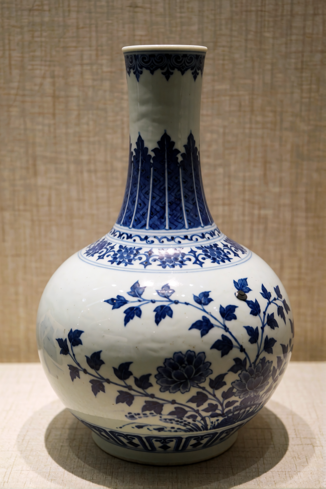
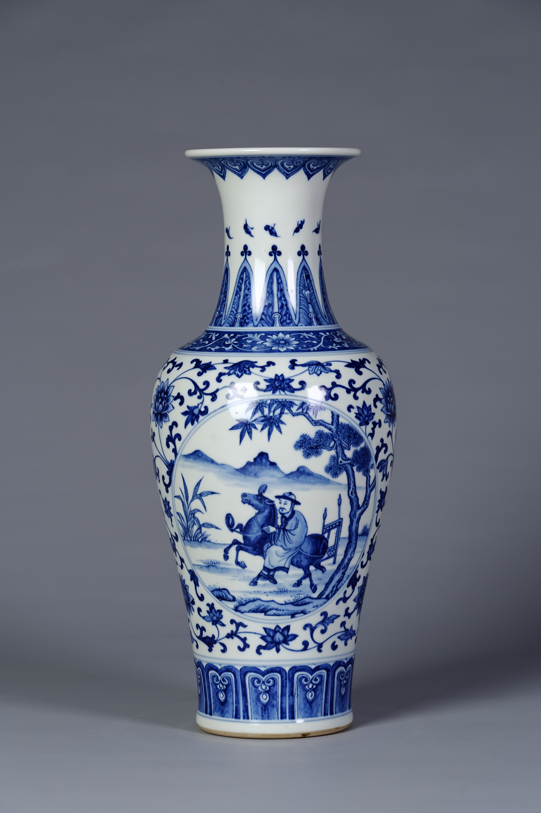
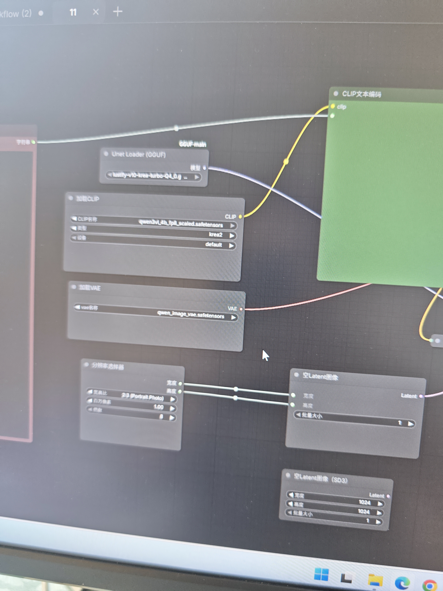
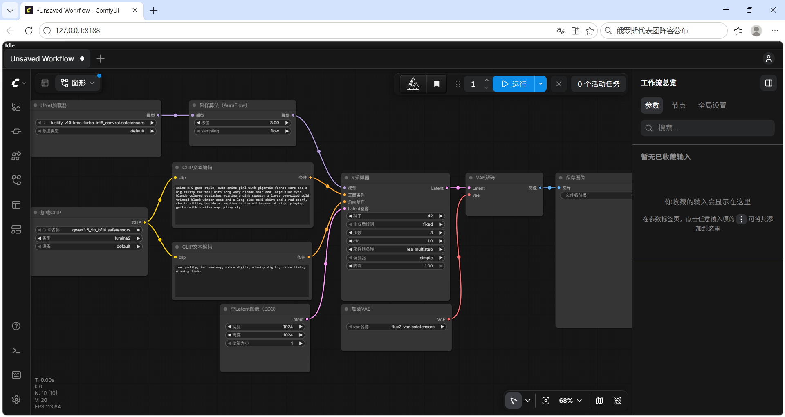
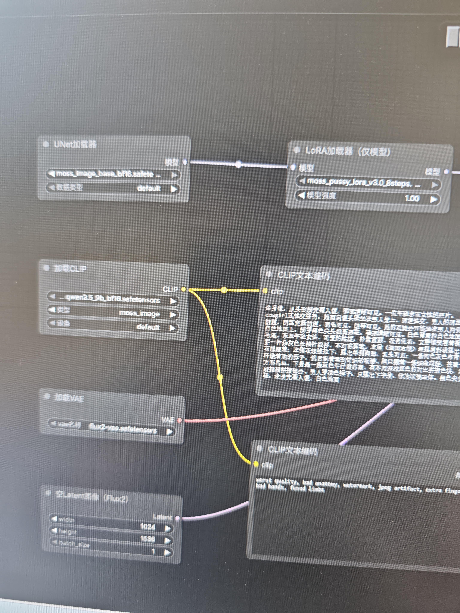
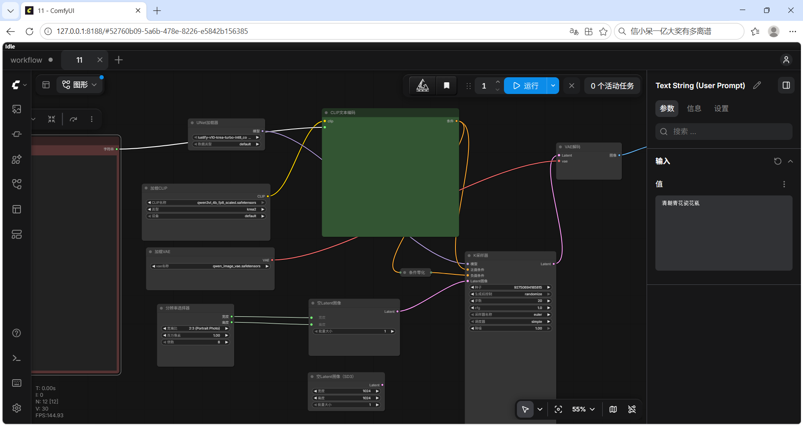

# ComfyUI Model Notes

> 个人 AI 模型链接索引与 ComfyUI 放置位置备忘
> 适配 4GB–12GB 显存设备

  <a href="#效果图">效果图</a> ·
  <a href="#模型总表">模型总表</a> ·
  <a href="#checkpoints">Checkpoints</a> ·
  <a href="#comfyui-路径映射">路径映射</a>

---

## 效果图

<table align="center">
  <tr>
    <td align="center" width="50%">
       
      <b>LUSTIFY! [NSFW checkpoint]</b> 配 Krea-2 工作流
    </td>
    <td align="center" width="50%">
       
      <b>Moss Image - Better Nudes</b> 配 MOSS-Image
    </td>
  </tr>
</table>

---

## 模型总表

| 模型名 | 类型 | 放置路径 | 链接 | 备注 |
|---|---|---|---|---|
| LUSTIFY! [NSFW checkpoint] | Checkpoint | `models/checkpoints/` | https://civitai.red/models/573152/lustify-nsfw-checkpoint | 配 Krea-2 工作流，含 text encoder / VAE |
| Moss Image - Better Nudes | Checkpoint | `models/checkpoints/` | https://civitai.red/models/3008073/moss-image-better-nudes | 配 MOSS-Image，含 diffusion model / text encoder / VAE |

---

## Checkpoints

### LUSTIFY! [NSFW checkpoint]

- **主模型**：https://civitai.red/models/573152/lustify-nsfw-checkpoint
- **放置路径**：`ComfyUI/models/checkpoints/`
- **对应工作流**：https://civitai.red/models/2503119/lustify-workflows-krea-2-sdxl?modelVersionId=3123550
- **版本备注**：自制 11（含义待确认）
- **配套来源**：Krea-2 https://huggingface.co/Comfy-Org/Krea-2/tree/main

**配套文件**

| 文件 | 来源目录 | 放置路径 |
|---|---|---|
| qwen3vl_4b_fp8_scaled.safetensors | `Krea-2/text_encoders` | `ComfyUI/models/text_encoders/` |
| qwen_image_vae.safetensors | `Krea-2/vae` | `ComfyUI/models/vae/` |
| 按实际下载文件名 | `Krea-2/diffusion_models` | `ComfyUI/models/diffusion_models/` |

> NSFW checkpoint；工作流为 Krea-2 / SDXL 相关，`diffusion_models` 下的文件按实际下载名放置。

<b>工作流参考图（2 张）</b>

  
  

### Moss Image - Better Nudes

- **主模型**：https://civitai.red/models/3008073/moss-image-better-nudes
- **放置路径**：`ComfyUI/models/checkpoints/`
- **配套来源**：MOSS-Image https://huggingface.co/Comfy-Org/MOSS-Image/tree/main

**配套文件**

| 文件 | 来源目录 | 放置路径 |
|---|---|---|
| moss_image_base_bf16.safetensors | `MOSS-Image/diffusion_models` | `ComfyUI/models/diffusion_models/` |
| qwen3.5_9b_bf16.safetensors | `MOSS-Image/text_encoders` | `ComfyUI/models/text_encoders/` |
| flux2-vae.safetensors | `MOSS-Image/vae` | `ComfyUI/models/vae/` |

> NSFW；MOSS-Image 仓库内文件已按类型标注，直接对照上表放置即可。

<b>工作流参考图（2 张）</b>

  
  

---

## ComfyUI 路径映射

| 模型类型 | 放置路径 | 说明 |
|---|---|---|
| Checkpoint | `ComfyUI/models/checkpoints/` | 完整主模型 |
| Diffusion Model / UNet | `ComfyUI/models/diffusion_models/` | 单独 diffusion model |
| Text Encoder | `ComfyUI/models/text_encoders/` | qwen3vl、qwen3.5 等 |
| LoRA | `ComfyUI/models/loras/` | 需与基座匹配 |
| VAE | `ComfyUI/models/vae/` | 单独 VAE，如 qwen_image_vae、flux2-vae |
| ControlNet | `ComfyUI/models/controlnet/` | 控制网模型 |
| Embeddings | `ComfyUI/models/embeddings/` | 文本反推 |
| CLIP Vision | `ComfyUI/models/clip_vision/` | IP-Adapter 等用 |
| Upscale | `ComfyUI/models/upscale_models/` | 放大模型 |
| 工作流 | `ComfyUI/user/default/workflows/` | 也可直接存 JSON 备注 |
